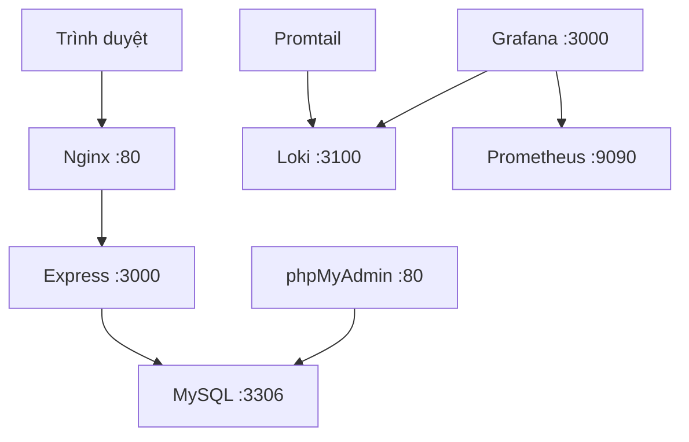

# Hệ Thống Blog CMS

**Đề tài thực hành số 07: Hệ Thống Blog CMS**

**Môn học:** Triển khai và Quản trị Hệ thống Phần mềm (K23)

**Sinh viên thực hiện:** Lê Thị Minh Huê - **MSV:** DTC245220026

**Chuyên ngành:** An toàn thông tin

**Đơn vị:** Khoa Công nghệ Thông tin - Trường Đại học Công nghệ Thông tin & Truyền thông (ICTU)

> README được đồng bộ với nhánh `feature/ui-refresh-technical-logs`, dựa trên
> commit `34852a9`, ngày 21/10/2026. Nhánh này chưa gộp vào `main`.
> Cài mới xem [hướng dẫn từ database rỗng](docs/cai-moi.md); nâng cấp trả lời tiếp
> cần [migration 006](docs/tra-loi-tiep.md) đúng một lần, không chạy lại 001–005.

## Mục lục

1. [Giới thiệu và chức năng](#1-giới-thiệu-và-chức-năng)
2. [Ngăn Xếp Công Nghệ (Technology Stack)](#2-ngăn-xếp-công-nghệ-technology-stack)
3. [Bảng Phân Bổ Cổng Dịch Vụ Thực Tế (Port Allocation)](#3-bảng-phân-bổ-cổng-dịch-vụ-thực-tế-port-allocation)
4. [Kiến trúc và cấu trúc mã nguồn](#4-kiến-trúc-và-cấu-trúc-mã-nguồn)
5. [Cài đặt mới và quản lý migration](#5-cài-đặt-mới-và-quản-lý-migration)
6. [Cập nhật và vận hành](#6-cập-nhật-và-vận-hành)
7. [Tài khoản, email và đăng nhập Google](#7-tài-khoản-email-và-đăng-nhập-google)
8. [Kiểm thử và nghiệm thu](#8-kiểm-thử-và-nghiệm-thu)
9. [Giám sát Prometheus và Grafana](#9-giám-sát-prometheus-và-grafana)
10. [Log tập trung và ba truy vấn LogQL](#10-log-tập-trung-và-ba-truy-vấn-logql)
11. [Bảo mật và hardening](#11-bảo-mật-và-hardening)
12. [Dữ liệu, sao lưu và dừng an toàn](#12-dữ-liệu-sao-lưu-và-dừng-an-toàn)
13. [Xử lý sự cố thường gặp](#13-xử-lý-sự-cố-thường-gặp)
14. [Hiện trạng, giới hạn và tài liệu](#14-hiện-trạng-giới-hạn-và-tài-liệu)

## 1. Giới thiệu và chức năng

Blog CMS quản lý và xuất bản bài viết, tích hợp MySQL/phpMyAdmin, Nginx reverse
proxy, giám sát Prometheus/Grafana và log tập trung Loki/Promtail.
Stack triển khai có **11 service Docker Compose**. Express dùng EJS để render
HTML phía server, CSS và JavaScript nội bộ hỗ trợ giao diện responsive.

| Đối tượng | Chức năng |
|---|---|
| Khách | Xem bài đã xuất bản; tìm tiêu đề/nội dung, lọc danh mục, sắp xếp, phân trang; đăng ký hoặc đăng nhập |
| READER — độc giả | Hồ sơ, đổi/quên mật khẩu, xác minh email, bình luận/trả lời, quản lý bình luận của mình, theo dõi chủ đề và nhận thông báo; gửi yêu cầu làm tác giả |
| AUTHOR — tác giả | Chức năng tài khoản/cộng đồng; tạo, sửa, xuất bản, chuyển nháp, xóa bài của mình; tải/thay/gỡ ảnh, xem lịch sử nội dung và bình luận trên bài mình |
| ADMIN — quản trị viên | Quản lý bài toàn hệ thống, danh mục, người dùng, yêu cầu quyền tác giả, kiểm duyệt bình luận; Nhật ký hệ thống gồm nhật ký hoạt động và nhật ký kỹ thuật |

### Bài viết và ảnh

- Bài mới là `DRAFT`, chưa có `published_at`; chỉ `PUBLISHED` xuất hiện công khai.
- AUTHOR chỉ quản lý bài của mình; dữ liệu tác giả không lấy từ form do người dùng gửi.
- Tìm kiếm tiêu đề/nội dung, lọc danh mục, sắp xếp mới/cũ/theo tiêu đề; công khai 10 bài/trang.
- Nội dung bài được escape và hiển thị dạng văn bản, không phải HTML editor.
- Ảnh nhận JPEG/PNG/WebP, tối đa 5 MiB và 20 triệu pixel; kiểm tra bằng Sharp,
  từ chối ảnh động/nhiều trang, xoay theo EXIF và thu nhỏ trong khung 1600 × 1600,
  không phóng lớn ảnh nhỏ; xuất WebP với tên UUID.
- Ảnh đi qua `GET /media/posts/:id/cover`, không mở thư mục uploads bằng static.
  Ảnh bài nháp chỉ ADMIN hoặc tác giả đang có phiên hợp lệ được xem.
- Thay/gỡ ảnh và xóa bài dùng transaction; dọn ảnh cũ sau commit.
  Database và filesystem không có chung transaction; lỗi dọn tệp được ghi nhận.

### Bình luận và thông báo

- Có thể trả lời bình luận hoặc tiếp tục trả lời bất kỳ câu trả lời đã hiển thị nào.
  Câu trả lời gom trong một cuộc trao đổi, ghi rõ đang trả lời ai.
- Độc giả và AUTHOR bình luận trên bài người khác chờ duyệt; ADMIN và AUTHOR trên
  bài mình được hiển thị ngay. Người bình luận phải xác minh email.
- Bình luận gốc và câu trả lời phân trang 10 mục; trang bài xem nhanh 5 câu trả lời
  mỗi nhóm. Không hiển thị nội dung chờ duyệt/đã ẩn cho người không có quyền.
- Thông báo gửi đúng người được trả lời và tác giả bài, loại người gửi/trùng người nhận.
  Mở bằng nút có CSRF sẽ đánh dấu đã đọc và dẫn đến đúng nội dung.
- Có tìm kiếm/lọc, đã đọc/chưa đọc, xem/thu gọn, ẩn/khôi phục thông báo.
  Thông báo trong website cập nhật khi tải trang; chưa có push thời gian thực.
- Nhật ký hoạt động ghi thao tác nghiệp vụ; lịch sử bài lưu phiên bản nội dung để xem.
  ADMIN mở menu **Nhật ký hệ thống** để chọn **Nhật ký hoạt động** (MySQL)
  hoặc **Nhật ký kỹ thuật** (Loki) tại `/admin/system-logs`.
  Trang kỹ thuật lọc dịch vụ/thời gian/nội dung, tối đa 500 dòng; timeout 8 giây
  bao gồm đọc phản hồi, giới hạn phản hồi 2 MiB. Lỗi Loki trả 502/504 và thông báo
  trên giao diện. Nội dung log được escape HTML nhưng không tự che mọi bí mật:
  không ghi mật khẩu/token vào log, chỉ cấp quyền xem cho ADMIN.

## 2. Ngăn Xếp Công Nghệ (Technology Stack)

Phiên bản dưới đây lấy từ `package.json`, `.nvmrc`, Dockerfile và `compose.yaml`;
tag image có thể thay đổi nội dung nếu không khóa digest.

| Lớp | Công nghệ / phiên bản trong repo | Vai trò |
|---|---|---|
| Runtime | Node.js 24; `.nvmrc` là 24.21.0; image `node:24-bookworm` và `node:24-bookworm-slim` | Build nhiều stage và chạy ứng dụng |
| Backend | Express 5.3.0, CommonJS | Route, middleware, controller, service, repository |
| Giao diện | EJS 7.0.1, HTML5, CSS3, Vanilla JavaScript | Render phía server, responsive, tương tác biểu mẫu |
| Database | MySQL `8.4`; `mysql2` 3.24.5 | InnoDB, `utf8mb4_0900_ai_ci`, transaction/khóa hàng; thời gian UTC |
| DB tool | `phpmyadmin:5.2.3-apache` | Quản trị MySQL |
| Phiên và CSRF | express-session 1.19.0, express-mysql-session 3.0.3; token CSRF từ node:crypto | Session lưu MySQL, kiểm tra POST |
| Mật khẩu | Argon2 0.45.1, thuật toán Argon2id | Băm/xác minh mật khẩu; thu hồi phiên bằng session_version |
| Ảnh | Multer 2.4.0, Sharp 0.35.5 | Nhận, kiểm tra và chuyển ảnh WebP |
| Email / Google | Nodemailer 10.1.0; google-auth-library 11.3.0, Google Identity Services | SMTP xác minh/khôi phục và đăng nhập/liên kết Google |
| Rate limit | express-rate-limit 8.7.1 | Giới hạn đăng nhập, tài khoản và bình luận tại ứng dụng |
| Reverse proxy | `nginx:stable-alpine` | Proxy, giới hạn body, security headers, access log JSON |
| Metrics | Prometheus 3.15.0, Grafana 13.2.3 | Thu thập và hiển thị dashboard |
| Exporter | nginx-prometheus-exporter 1.5.1, mysqld-exporter 0.20.0, cAdvisor 0.60.6 | Metrics web server, database và container |
| Logging | Loki 3.6.17, Promtail 3.5.11, LogQL | Log tập trung, lưu filesystem, retention 7 ngày |
| Hạ tầng | Docker Engine + Docker Compose v2, Git/GitHub | Đóng gói, mạng, volume và quản lý phiên bản |

Môi trường đã dùng: Ubuntu 24.04 trên WSL, Docker 29.1.3, Compose 2.40.3.
Mật khẩu dùng **Argon2id**, không phải Bcrypt; xác thực website dùng session,
không phải JWT ứng dụng. Token Google được kiểm tra phía server bằng thư viện Google.

## 3. Bảng Phân Bổ Cổng Dịch Vụ Thực Tế (Port Allocation)

Đây là phân bổ trong Compose và `.env.example`, khớp các cổng đã dùng ở lab.
`.env` thật có thể ghi đè các cổng có biến môi trường.
Dùng `docker compose ps` để xác nhận mapping đang chạy trước khi chụp minh chứng.

| Dịch vụ | URL / địa chỉ trên máy host | Bind host → cổng container | Chức năng |
|---|---|---|---|
| Website qua Nginx | http://localhost:18090/ | `127.0.0.1:18090 → 80` | Điểm vào website; không phải bind 0.0.0.0 |
| phpMyAdmin | http://localhost:18091/ | `127.0.0.1:${PHPMYADMIN_HOST_PORT} → 80`; mẫu 18091 | Giao diện quản trị DB |
| Grafana | http://localhost:13000/ | `127.0.0.1:13000 → 3000` | Dashboard metrics/log |
| Prometheus | http://localhost:19090/ | `127.0.0.1:19090 → 9090` | Targets và PromQL |
| Loki | http://localhost:13100/ready | `127.0.0.1:${LOKI_HOST_PORT:-13100} → 3100` | Readiness và API LogQL, không phải giao diện duyệt log |
| MySQL | `127.0.0.1:13319` | `127.0.0.1:${MYSQL_HOST_PORT} → 3306`; mẫu 13319 | CLI/DB client; không phải URL HTTP |
| App Express | Không publish ra host | Nội bộ `app:3000` | Backend sau Nginx |
| Nginx stub_status | Không publish ra host | Nội bộ `nginx:8080/stub_status` | Exporter đọc thống kê Nginx |
| Nginx exporter | Không publish ra host | Nội bộ `nginx-exporter:9113` | Metrics Nginx |
| MySQL exporter | Không publish ra host | Nội bộ `mysql-exporter:9104` | Metrics MySQL |
| cAdvisor | Không publish ra host | Nội bộ `cadvisor:8080` | Metrics container |
| Promtail | Không publish ra host | Nội bộ `promtail:9080` | HTTP endpoint của collector |

Express lắng nghe `0.0.0.0:3000` **bên trong container**, nhưng không có host port.
Khi chạy Express trực tiếp trong WSL, nó dùng host 18090; không chạy đồng thời
với Nginx Compose đang chiếm cổng đó. Bảng này không dùng cổng của dự án Quiz
hoặc các stack WordPress/Grafana khác trên máy.

## 4. Kiến trúc và cấu trúc mã nguồn



Prometheus scrape exporter Nginx/MySQL và cAdvisor. Promtail đọc Docker JSON log
của app, Nginx, MySQL và phpMyAdmin; Grafana truy vấn Prometheus và Loki.
App tham gia cả database, proxy và monitoring để truy vấn Loki từ trang quản trị.

| Đường dẫn | Nội dung |
|---|---|
| `src/config` | Biến môi trường, MySQL pool, session store |
| `src/routes`, `middlewares` | Route, xác thực/phân quyền, CSRF, upload/rate limit |
| `src/controllers`, `services`, `repositories`, `validators` | HTTP, nghiệp vụ, SQL và validation |
| `views`, `public/css`, `public/js` | EJS, CSS và JavaScript giao diện |
| `db/migrations` | SQL nâng schema tuần tự 001–006 |
| `infra` | Nginx, Prometheus, Grafana, Loki và Promtail |
| `scripts` | Tạo tài khoản, kiểm tra session và nguồn log |
| `tests` | Bộ kiểm thử Node/Python |
| `docs` | Hướng dẫn triển khai, thiết kế và nghiệm thu |

## 5. Cài đặt mới và quản lý migration

### Điều kiện

- Docker Engine/Compose v2, Git, Node 24 qua nvm và Python 3.
- Cổng ở mục 3 còn trống; subnet proxy `172.26.0.0/24` không trùng mạng khác.
- Lab dùng Docker rootful, Docker Root Dir `/var/lib/docker`, cgroup v2 và
  `/dev/kmsg` cho cAdvisor. Không mặc định áp dụng nguyên cấu hình cho rootless.
- App/Grafana/MySQL exporter dùng UID/GID 1000; thư mục bind mount phải có quyền
  phù hợp, không dùng `chmod 777`.

### Clone đúng nhánh

```bash
git clone --branch feature/ui-refresh-technical-logs https://github.com/hscret7/blog-cms.git
cd blog-cms
nvm use
npm ci
```

Nếu repository private, cần quyền GitHub. Không chèn access token vào URL/lệnh.

**Làm đầy đủ theo [docs/cai-moi.md](docs/cai-moi.md)**, theo thứ tự:

1. Tạo `.env` từ mẫu, sinh mật khẩu riêng và `SESSION_SECRET` ngẫu nhiên 64 ký tự hex.
2. Chuẩn bị `uploads/covers`, `secrets` và quyền thư mục.
3. Khởi động MySQL/phpMyAdmin, chờ healthy.
4. Chạy **001 → 002 → 003 → 004 → 005 → 006** đúng một lần trên database rỗng.
5. Tạo user giám sát `blog_exporter`, tệp `secrets/mysql-exporter.cnf` và
   `secrets/grafana-admin-password`.
6. Build app, tạo ADMIN bằng CLI; chạy website, metrics và Grafana.
7. Sinh targets log, bật Loki/Promtail và kiểm chứng.

Không chỉ `cp .env.example .env` rồi chạy toàn bộ stack:
mẫu chứa placeholder, Compose cần secrets/targets và database cần schema.
Repo hiện **không có** script `npm run migrate`, `npm run seed`,
`npm run test:integration` hoặc seed tài khoản/mật khẩu mẫu tự động.
SQL migration **không idempotent**; DDL MySQL không đảm bảo rollback toàn bộ.

| Migration | Chức năng |
|---|---|
| 001 | users, categories, posts và ràng buộc nghiệp vụ |
| 002 | sessions |
| 003 | READER, xác minh email, phiên bản phiên và account_tokens |
| 004 | comments, follows, notifications, audit_events, post_versions |
| 005 | Trả lời theo nhóm, ẩn thông báo, yêu cầu AUTHOR, danh tính/challenge Google |
| 006 | reply_to_id, trả lời tiếp đúng đích, backfill câu trả lời cũ |

Database đã có: sao lưu và kiểm tra schema trước khi chỉ chạy migration còn thiếu.
Bản nâng cấp 006 có hướng dẫn riêng ở [docs/tra-loi-tiep.md](docs/tra-loi-tiep.md).
Đổi `MYSQL_PASSWORD` trong `.env` không tự đổi mật khẩu MySQL đã khởi tạo.

## 6. Cập nhật và vận hành

Các khối dưới chạy trong **Terminal Ubuntu/WSL**, tại thư mục gốc dự án.
Chỉ cập nhật sau khi xác nhận nhánh đúng, các thay đổi local đã được lưu và schema
đã đủ cho mã mới. Không dùng reset/clean để bỏ thay đổi Antigravity.

### Cập nhật code và image app

```bash
(
  set -e
  git status --short --branch
  test -z "$(git status --porcelain)" || {
    printf 'Có thay đổi local, dừng để xử lý trước.\n'
    exit 1
  }
  git pull --ff-only
  nvm use
  npm ci
  npm test
  python3 tests/log-targets.test.py
  git diff --check
  docker compose config --quiet
  docker build -t blog-cms-app:local .
  docker compose up -d --no-build --no-deps --force-recreate \
    --wait --wait-timeout 240 app
  docker compose exec -T nginx nginx -s reload
  python3 scripts/prepare-log-targets.py
  python3 scripts/verify-central-logs.py
)
```

Đây không phải lệnh tự chạy migration. Nếu code yêu cầu schema mới, hoàn tất
migration phù hợp trước khi recreate app. Refresh nguồn log sau **mỗi lần recreate
app/nginx/mysql/phpmyadmin**, kể cả khi vẫn dùng cùng service name.

### Kiểm tra trạng thái

```bash
docker compose ps
docker compose logs --tail=30 app nginx
curl --max-time 10 -fsS -w '\nHTTP %{http_code}\n' http://127.0.0.1:18090/health/live
curl --max-time 10 -fsS -w '\nHTTP %{http_code}\n' http://127.0.0.1:18090/health/ready
```

Liveness chỉ kiểm tra HTTP; readiness kiểm tra MySQL bằng `SELECT 1`,
không kiểm tra đủ schema hoặc xác nhận mọi chức năng đều tốt.
Exporter/Promtail không có healthcheck trong Compose; `Up` chưa chứng minh scrape.

### Kiểm tra Nginx

Đang chạy: `docker compose exec -T nginx nginx -t`, sau đó mới
`docker compose exec -T nginx nginx -s reload`.

Kiểm tra độc lập, không tranh IP tĩnh với Nginx đang chạy:

```bash
docker run --rm --network none \
  --mount "type=bind,src=$PWD/infra/nginx/default.conf,dst=/etc/nginx/conf.d/default.conf,readonly" \
  nginx:stable-alpine nginx -t
```

Không dùng `docker compose run nginx` khi service hiện hữu đã chiếm IP
`172.26.0.10`.

### Chạy Express trực tiếp trong WSL để phát triển

Dừng Nginx Compose nếu cần nhường host 18090, đặt `DB_HOST=127.0.0.1`,
`DB_PORT=13319` và `TRUSTED_PROXY_IP=` trong cấu hình local.
Giữ MySQL hoạt động, rồi `nvm use`, `npm ci`, `npm run dev`.
Thay cấu hình local không tự thay environment của container đã tạo.

## 7. Tài khoản, email và đăng nhập Google

**Không có tài khoản demo/mật khẩu mặc định được cam kết trong repo.**
Không công bố tài khoản thật, hash mật khẩu hoặc thông tin SMTP trong README.

- Tạo ADMIN ban đầu bằng `docker compose run --rm --no-deps app npm run create-admin`
  sau khi build image và chuẩn bị schema; chạy trong terminal tương tác.
- Có `npm run create-author` tương tự. ADMIN cũng tạo người dùng từ giao diện.
- Website: đăng nhập tại http://localhost:18090/login và thao tác bằng menu/tài khoản.
- Đăng ký công khai luôn tạo READER. Chọn muốn làm tác giả chỉ gửi yêu cầu;
  ADMIN xét duyệt, không tự cấp AUTHOR hoặc ADMIN.
- Mật khẩu website: **8–128 ký tự**, có chữ hoa A–Z, chữ thường a–z,
  chữ số 0–9 và ký tự đặc biệt; không tự trim mật khẩu.
- phpMyAdmin: dùng `MYSQL_USER`/`MYSQL_PASSWORD` trong `.env`, không dùng root
  cho nghiệp vụ ứng dụng.
- Grafana: user khởi tạo `admin`, mật khẩu riêng trong
  `secrets/grafana-admin-password`. Sửa tệp này không tự đổi mật khẩu đã lưu
  của một Grafana đã khởi tạo.

### Cấu hình tùy chọn

| Biến | Ý nghĩa |
|---|---|
| PUBLIC_BASE_URL | Origin website; HTTP chỉ chấp nhận localhost/127.0.0.1, public phải HTTPS |
| SMTP_HOST, SMTP_PORT, SMTP_SECURE | SMTP; mặc định port 587, SMTP_SECURE=false sử dụng STARTTLS bắt buộc |
| SMTP_USER, SMTP_PASSWORD, SMTP_FROM | Xác thực gửi email và địa chỉ gửi |
| GOOGLE_CLIENT_ID | OAuth Web Client ID của Google Cloud; không phải mật khẩu Gmail |
| SESSION_SECRET | Khóa ký session, 64 ký tự hex ngẫu nhiên; bắt buộc |
| DOCKER_LOG_ROOT | Thư mục Docker container logs, mặc định /var/lib/docker/containers |
| LOKI_HOST_PORT | Cổng Loki host, mặc định 13100 |

SMTP và Google là **hai tích hợp riêng**. Chưa cấu hình SMTP thì đăng ký/xác minh/
quên mật khẩu chưa hoạt động đầy đủ, nhưng app và tài khoản được cấp qua CLI vẫn
có thể dùng. Google cần chủ tài khoản cấu hình OAuth origins khớp URL truy cập.
Backend kiểm tra chữ ký, audience, issuer, expiry và nonce dùng một lần; không
tự gộp tài khoản theo email. Liên kết/gỡ liên kết có kiểm tra tài khoản hiện hữu.
Xem [hướng dẫn Google](docs/cap-nhat-tuong-tac-google.md) và
[hướng dẫn email](docs/cap-nhat-cong-dong.md).

## 8. Kiểm thử và nghiệm thu

Chạy trên host, không giả định runtime image có thư mục tests:

```bash
nvm use
npm ci
npm test
python3 tests/log-targets.test.py
npm audit
git diff --check
```

Dockerfile hiện không COPY `tests/`; không dùng
`docker compose exec app npm test` như hướng dẫn của dự án khác.

Kết quả đã ghi nhận tại mốc mã 16/10/2026: **153 test Node và 8 test Python đạt**;
audit tại mốc đó báo 0 lỗ hổng. Kết quả rà soát nhánh mới xem `docs/ra-soat-nhat-ky-ky-thuat.md`.
Bộ test bao gồm validation, phân quyền, CSRF, tài khoản/token/Google, ảnh,
thông báo/trả lời, tìm kiếm và render EJS; nhiều ca DB/SMTP dùng fixture.

Nghiệm thu thật cần kiểm tra thêm:

- CRUD và quyền ADMIN/AUTHOR/READER; chặn truy cập bài của người khác.
- Đăng nhập, đổi/reset mật khẩu, khóa/mở khóa và thu hồi phiên.
- SMTP gửi/nhận email thật; đăng nhập/liên kết Google bằng provider thật.
- Ảnh, bình luận/trả lời tiếp, kiểm duyệt, đích thông báo và phân trang nhiều trang.
- Desktop/mobile sau lần sửa bố cục mới nhất.
- Trạng thái database, metrics và log sau recreate.

Chi tiết: [rà soát](docs/ra-soat-du-an.md),
[UI](docs/kiem-thu-giao-dien.md), [thông báo](docs/thong-bao-binh-luan.md),
[trả lời tiếp](docs/tra-loi-tiep.md). Không đánh dấu PASS chỉ vì có code hoặc menu.

## 9. Giám sát Prometheus và Grafana

- [Prometheus targets](http://localhost:19090/targets): cấu hình có **4 job**,
  `prometheus`, `nginx`, `mysql`, `cadvisor`.
- [Dashboard tổng quan](http://localhost:13000/d/blog-cms-overview).
- Datasource `Blog CMS Prometheus`, UID `blog-cms-prometheus`.
- Scrape/evaluation mỗi 15 giây; timeout scrape 5 giây.
- Prometheus retention 7 ngày hoặc ngưỡng 1GB; không phải quota cứng toàn volume.
- CPU/RAM app được lấy qua cAdvisor; **chưa có job scrape /metrics của Express**.
  CPU 100% tương ứng một lõi; RAM dùng working set.

PromQL tham khảo:

```promql
up{project="blog-cms"}
```

```promql
nginx_up{project="blog-cms"}
```

```promql
mysql_up{project="blog-cms"}
```

Tạo lưu lượng website để quan sát tốc độ yêu cầu Nginx:

```bash
for attempt in $(seq 1 30); do
  curl --max-time 5 -fsS -o /dev/null http://127.0.0.1:18090/ || break
done
```

Không dùng healthcheck để tạo minh chứng access log: Nginx chủ động bỏ
`/health/live` và `/health/ready` khỏi access log.

## 10. Log tập trung và ba truy vấn LogQL

Nguồn log: app, nginx, mysql, phpmyadmin. Promtail chọn đúng Compose project qua
`runtime/promtail-targets/containers.json`, không dùng Docker socket.
Loki lưu filesystem, schema TSDB v13, retention 168 giờ.
Nginx access log là JSON gồm ts/method/path/status/duration/bytes, không ghi query,
cookie hoặc Authorization. Log app/MySQL không mặc định có cùng cấu trúc JSON.

Sau khi khởi động hoặc recreate nguồn log:

```bash
python3 scripts/prepare-log-targets.py
python3 scripts/verify-central-logs.py
```

Script tạo một request 404 có marker và kiểm tra marker đến Loki, sau đó chạy ba
query. Nếu đổi website/Loki host port, truyền `--website` và `--loki` với origin
HTTP localhost phù hợp; các URL README mặc định cần cập nhật tương ứng.

Mở [Grafana Explore](http://localhost:13000/explore), chọn **Blog CMS Loki**,
UID `blog-cms-loki`, khoảng **Last 1 hour**, rồi chạy:

**1. Log bốn dịch vụ Blog CMS**

```logql
{project="blog-cms",service=~"app|nginx|mysql|phpmyadmin"}
```

**2. Lỗi HTTP Nginx 4xx và 5xx**

```logql
{project="blog-cms",service="nginx"} | json | __error__="" | status >= 400
```

**3. Số dòng log theo dịch vụ trong 10 phút**

```logql
sum by (service) (
  count_over_time({project="blog-cms",service=~"app|nginx|mysql|phpmyadmin"}[10m])
)
```

Query 3 đếm **dòng log**, không phải số request hoặc số lỗi.
[Dashboard log](http://localhost:13000/d/blog-cms-logs) được provision riêng.
Log startup MySQL/phpMyAdmin có thể nằm ngoài Last 1 hour; thử Last 7 days.
Không có log mới của một service không tự có nghĩa service bị lỗi.

Sinh viên đã cung cấp kết quả marker 404 và cả ba query có dữ liệu ở mốc
triển khai. Ảnh minh chứng cần lấy trên phiên bản demo cuối.
Chi tiết: [docs/log-tap-trung.md](docs/log-tap-trung.md).

**Promtail đã EOL**: giữ trong lab để đáp ứng yêu cầu học phần; chuyển Alloy
nếu vận hành dài hạn. Không mô tả Promtail còn được hỗ trợ tích cực hoặc cam kết
hoạt động “100%”. Retention không khôi phục log Docker đã bị xoay/xóa trước khi thu.

## 11. Bảo mật và hardening

| Biện pháp | Triển khai hiện tại |
|---|---|
| App non-root | Dockerfile USER node, UID/GID 1000 |
| Hạn chế ghi/quyền | App read_only, tmpfs /tmp, cap_drop ALL, no-new-privileges |
| Tách mạng | database, proxy, monitoring; app không publish cổng host |
| Cổng cục bộ | Các port publish trong Compose bind 127.0.0.1 |
| Mật khẩu | Argon2id; tài khoản và secrets riêng; session_version để thu hồi phiên |
| Session | MySQL store, HttpOnly, SameSite=Lax, 8 giờ; regenerate khi đăng nhập |
| CSRF/quyền | POST kiểm tra CSRF; quyền server; transaction kiểm tra actor/khóa hàng |
| SQL/XSS | Truy vấn tham số hóa, danh sách sort được phép, EJS escape nội dung |
| Upload | Giới hạn dung lượng/pixel, kiểm tra ảnh thực, UUID, không static uploads |
| Proxy | App chỉ tin Nginx 172.26.0.10; Nginx ghi đè forwarded headers |
| Security headers | nosniff; X-Frame-Options DENY; Referrer-Policy; Permissions-Policy |
| Đăng nhập | POST /login tối đa 10 lượt/15 phút/IP, tính cả thành công/thất bại |
| Secrets | .env, secrets, uploads, runtime, backups ngoài Git và build context |
| Log rotation | Docker json-file max-size 10m, max-file 3 |

Giới hạn cần nói rõ:

- HTTP localhost chưa có HTTPS; cookie `Secure=false`. Headers không mã hóa dữ liệu.
  Muốn công khai ra Internet cần TLS và cấu hình cookie phù hợp.
- Không có CSP hoặc Nginx `limit_req 30r/s` trong cấu hình hiện tại.
- **Không phải mọi container đều non-root**: Promtail chạy root để đọc log,
  cAdvisor privileged và mount host để quan sát metrics.
- Các mạng bridge chưa đặt `internal: true`; tách mạng không phải cách ly tuyệt đối.
  MySQL exporter tham gia cả database và monitoring.
- Promtail mount log root chỉ đọc nhưng vẫn có khả năng đọc thư mục log của
  container khác; giới hạn project nằm ở discovery/pipeline, không phải sandbox file.
- User ứng dụng không phải root nhưng còn quyền trong database để migration;
  chưa tách tài khoản migration/runtime. `blog_exporter` có PROCESS,
  REPLICATION CLIENT, SELECT toàn server, tối đa 3 kết nối; chỉ dùng giám sát.
- Rate limit dùng memory của một app instance, mất khi restart, không chia sẻ nhiều replica.

Kiểm tra một số minh chứng mà không in environment/secrets:

```bash
docker compose exec -T app node -e 'console.log("UID:", process.getuid())'
docker inspect "$(docker compose ps -q app)" \
  --format 'ReadonlyRootfs={{.HostConfig.ReadonlyRootfs}} | CapDrop={{json .HostConfig.CapDrop}} | SecurityOpt={{json .HostConfig.SecurityOpt}} | PortBindings={{json .HostConfig.PortBindings}}'
curl --max-time 10 -sS -D - -o /dev/null http://127.0.0.1:18090/health/ready
git ls-files .env secrets uploads runtime backups
```

Lệnh Git cuối mong đợi không có kết quả. Không chụp toàn bộ `docker inspect`,
`docker compose config` đã render hoặc `.env` vì có thể lộ credentials.

## 12. Dữ liệu, sao lưu và dừng an toàn

| Nơi lưu | Dữ liệu |
|---|---|
| mysql_data | Bảng nghiệp vụ và session |
| ./uploads → /app/uploads | Ảnh đại diện WebP |
| prometheus_data | Metrics |
| grafana_data | Tài khoản/cấu hình và trạng thái Grafana |
| loki_data | Log/index Loki |
| promtail_positions | Vị trí đọc log |
| .env, secrets/ | Cấu hình và bí mật ngoài Git, cần bảo quản riêng |

**Trước migration hoặc nâng cấp quan trọng**, sao lưu SQL và ảnh ở cùng thời điểm.
Ví dụ dưới dừng app để tránh ghi nghiệp vụ trong lúc sao lưu; không phải backup
toàn bộ metrics/Grafana/Loki. Nếu bước nào lỗi, app có thể còn dừng: kiểm tra lỗi
trước khi tiếp tục, không xóa volume.

```bash
(
  set -e
  umask 077
  backup_dir="backups/manual-$(date -u +%Y%m%dT%H%M%SZ)"
  mkdir -p "$backup_dir"
  docker compose stop app
  docker compose exec -T mysql sh -c '
    MYSQL_PWD="$MYSQL_PASSWORD" exec mysqldump \
      --protocol=TCP --host=127.0.0.1 --user="$MYSQL_USER" \
      --single-transaction --no-tablespaces --databases "$MYSQL_DATABASE"
  ' > "$backup_dir/database.sql"
  test -s "$backup_dir/database.sql"
  tar -czf "$backup_dir/uploads.tar.gz" uploads
  gzip -t "$backup_dir/uploads.tar.gz"
  docker compose up -d --no-build --no-deps --wait --wait-timeout 240 app
  docker compose exec -T nginx nginx -s reload
  printf 'Đã tạo backup SQL và ảnh: %s\n' "$backup_dir"
)
```

Backup không thay thế kiểm thử restore. Khôi phục thử vào **database/Compose project
cách biệt**, kiểm tra số bảng/bản ghi, đăng nhập và ảnh rồi mới lập quy trình phục
hồi môi trường thật. Không import dump chứa `--databases` tùy ý vào MySQL đang dùng.
Secrets cần bản sao bảo mật riêng, không đẩy Git/Grafana hoặc đưa vào báo cáo.

Dừng rồi chạy lại, giữ container:

```bash
docker compose stop
docker compose start
```

Gỡ container/network, giữ named volume và bind mount:

```bash
docker compose down
```

**Không dùng `docker compose down -v` hoặc prune volumes khi cần giữ dữ liệu.**
Sau `down`, container nguồn log bị tạo lại khi `up`: khởi động các service nguồn,
chạy lại `prepare-log-targets.py`, rồi kiểm chứng log theo tài liệu.
Không coi dữ liệu tồn tại ngoài container là đã có backup an toàn.

## 13. Xử lý sự cố thường gặp

| Hiện tượng | Kiểm tra / xử lý |
|---|---|
| Cổng đã dùng | Xem `docker compose ps`, `ss -ltn`; đối chiếu bảng cổng, không dừng stack khác tùy ý |
| Bind mount không tồn tại / permission denied | Chuẩn bị uploads/secrets/targets và UID 1000 theo hướng dẫn cài mới |
| App lỗi thiếu bảng/cột | Kiểm tra migration, đặc biệt 006; readiness có thể vẫn 200; không chạy lại toàn bộ SQL |
| Nginx trùng IP khi kiểm tra | Dùng exec nginx -t hoặc docker run --network none, không compose run nginx |
| HTTP 502 / health đang phục hồi | Kiểm tra app healthy, nginx -t, reload Nginx; xem log app/nginx |
| Đăng nhập 429 | Chờ Retry-After; bộ đếm theo IP; không restart liên tục để né limiter |
| Đăng nhập/ảnh/CSRF dùng phiên cũ | Tải lại trang, đăng nhập lại; kiểm tra phiên bị thu hồi, không bỏ CSRF |
| Google chưa cấu hình hoặc không phản hồi | Client ID/origins phải khớp; kiểm tra callback JS và app log, không cung cấp mật khẩu Gmail cho website |
| Email không đến | Kiểm tra SMTP/STARTTLS, địa chỉ gửi và hộp spam; không in SMTP_PASSWORD |
| Loki không thấy log sau recreate | Sinh lại targets, kiểm tra quyền đọc log/Docker Root Dir, chạy verify script |
| Dashboard log rỗng | Chọn Blog CMS Loki, đúng thời gian và project/service; khác datasource Prometheus |
| Grafana đổi secret nhưng không đổi password | Secret khởi tạo không tự cập nhật DB Grafana; dùng quy trình đổi/reset của Grafana |
| Chạy npm test trong runtime image thất bại | Tests không có trong image; chạy npm test trên checkout host |

## 14. Hiện trạng, giới hạn và tài liệu

Các mốc commit kỹ thuật có ý nghĩa:

| Mốc | Commit |
|---|---|
| Nginx reverse proxy và security headers | `9dadc5c` |
| Prometheus/Grafana và exporter/cAdvisor | `15c40b4` |
| Loki/Promtail và LogQL | `c7f9586` |
| Thu hồi phiên, kiểm thử hồi quy và cài mới | `085deb2` |
| Sửa luồng mở/duyệt thông báo và README | `1370b2e` |
| Trả lời tiếp vào mọi câu trả lời, migration 006 | `0655163` |

Không coi PR mở là đã merge. Khi nộp bài cần chỉ rõ nhánh/commit chạy demo và bảo
đảm mọi thay đổi local cần bàn giao đã commit/push. Repo hiện thuộc tài khoản
`hscret7`; thông tin MSV trên README không tự thay tên tài khoản GitHub theo
yêu cầu riêng của giảng viên.

Các phần **chưa hoàn thiện hoặc chưa có đủ minh chứng**: cảnh báo tự động;
CI; migration runner; backup/restore tự động; cleanup token/challenge; đối soát
ảnh còn sót; kiểm thử tải/HA; kiểm chứng SMTP và nghiệm thu lại bố cục/nhật ký kỹ thuật trên máy thật.
Migration 006 và luồng trả lời đã được sinh viên ghi nhận kiểm tra trong
`docs/tra-loi-tiep.md`; không chạy lại migration chỉ vì cập nhật giao diện. Không sửa các mục này thành PASS nếu chưa kiểm tra.

Tài liệu chi tiết:

- [Cài mới](docs/cai-moi.md).
- [Cập nhật tài khoản và cộng đồng 003/004](docs/cap-nhat-cong-dong.md).
- [Google và tương tác 005](docs/cap-nhat-tuong-tac-google.md).
- [Trả lời tiếp 006](docs/tra-loi-tiep.md).
- [Quy tắc thông báo/bình luận](docs/thong-bao-binh-luan.md).
- [Log tập trung và LogQL](docs/log-tap-trung.md).
- [Kiểm tra giao diện](docs/kiem-thu-giao-dien.md).
- [Kết quả rà soát kỹ thuật](docs/ra-soat-du-an.md).
- [Phạm vi](docs/pham-vi.md), [thiết kế dữ liệu](docs/thiet-ke-du-lieu.md).

Báo cáo môn học cần bìa đúng thông tin sinh viên, tối thiểu 10 trang và ảnh minh
chứng GitHub/Compose, website/DB tool, Nginx, Grafana/Prometheus, ba LogQL và ít
nhất 3–4 biện pháp hardening. Các tài liệu mô tả mốc cũ không thay thế kết quả
nghiệm thu của phiên bản demo cuối.

